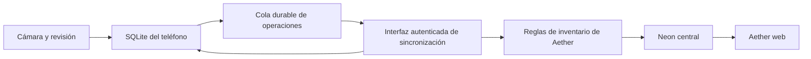

# Inventario móvil de Aether: propuesta de operación local y sincronizada

Fecha: 21 de octubre de 2026. Estado: análisis y propuesta; no implementado.

## Necesidad confirmada

Un operario debe poder recibir, retirar y contar mercadería con un teléfono, fotografiar etiquetas para extraer producto, código, lote, vencimiento, kilos o unidades, y continuar cuando pierde señal. Lo registrado debe quedar en una base local y llegar a Aether web al recuperar conexión.

Se interpreta «local y web» como operación del teléfono sin conexión y posterior sincronización con el ERP central. Si también se necesita que una computadora opere sin internet, la vista web de bodega necesitará almacenamiento y sincronización propios; el manifest actual no entrega esa capacidad. Un servidor completo instalado en la bodega sería otro alcance.

## Recomendación

Crear una app de bodega con React Native + Expo, SQLite local y lectura de códigos y texto en el dispositivo. Mantener Next.js y Neon como plataforma central, compartiendo las reglas de inventario existentes. La web sigue sirviendo para supervisión y administración; las mismas operaciones quedan disponibles allí.

| Alternativa | Ventaja | Trabajo o límite relevante | Evaluación |
| --- | --- | --- | --- |
| Web instalable/PWA | Reutiliza más interfaz y distribución sencilla | Hay que construir persistencia offline, gestionar límites del navegador y resolver lectura local de etiquetas entre navegadores | Viable para uso principalmente conectado |
| React Native + Expo | Base local persistente y acceso a capacidades nativas de cámara/OCR | Nueva interfaz móvil, compilaciones y adaptador nativo de OCR | Recomendada para este requisito de trabajo sin señal |
| Contenedor Capacitor sobre una vista web móvil | Reutiliza React y permite plugins nativos | Requiere igualmente SQLite, puente OCR, sincronización y pruebas nativas | Alternativa si el equipo prioriza reutilizar la UI web |

Esta elección es una propuesta técnica, no una decisión de migrar todo Aether. Las pantallas móviles serán nuevas; compartir TypeScript no implica reutilizar directamente componentes HTML de Next.js.

## Qué ya existe en el repositorio

| Capacidad | Evidencia | Uso propuesto |
| --- | --- | --- |
| Producto, SKU, código, unidad y empaques con factor | `prisma/schema.prisma`: `Product`, `ProductPackaging`; `src/modules/inventory/services/products.service.ts` | Identificación local y conversión caja → unidades |
| Stock por bodega, entradas, salidas y transferencias | `src/modules/inventory/services/stock.service.ts` | Conservar transacciones, bloqueos y PMP centrales |
| Lotes, vencimientos y consumo FEFO | `InventoryLot`; `src/lib/inventory/lots.ts` | Base de trazabilidad; ampliar para elegir el lote físico |
| Conteos y contabilización de diferencias | `src/modules/inventory/services/inventory-count.service.ts` | Captura móvil con revisión antes de ajustar |
| Recepción contra orden de compra | `src/modules/purchases/services/goods-receipt.service.ts` | Recibir cantidades y lotes sin pedir al operario que digite costos |
| Extracción de fotos con Gemini | `src/modules/import/services/ai-scan.service.ts` | Referencia del patrón extraer → revisar → confirmar; actualmente orientado a facturas y dependiente de internet |
| Manifest instalable | `src/app/manifest.ts` | Ya ofrece metadatos de instalación del ERP |
| Service worker de notificaciones | `public/sw.js` | Declara expresamente que no tiene caché offline |

La inspección no encontró una base local de inventario, cola durable de sincronización ni lector de etiquetas por cámara en el módulo. El grafo Graphify orientó la navegación, pero sus líneas estaban desactualizadas; las conclusiones se contrastaron con el código actual.

## Interfaz del operario

Inicio con bodega seleccionada, estado de conexión, operaciones pendientes y cuatro botones grandes:

| Botón | Flujo |
| --- | --- |
| Entrar mercadería | Abrir tarea/recepción → escanear o fotografiar → cantidad → confirmar |
| Sacar mercadería | Escanear producto y lote → cantidad → destino o motivo → confirmar |
| Contar existencias | Abrir conteo asignado → escanear → ingresar lo contado → guardar |
| Consultar | Escanear/buscar → ver saldo local, lotes, vencimientos y fecha de actualización |

Las transferencias se presentan como una opción de destino al sacar mercadería. El supervisor asigna tareas y revisa diferencias desde la web. La bodega se recuerda o se asigna al usuario; una asignación debe validarse en servidor si también limita acceso, porque ocultar otras bodegas no es autorización.

Una tarea por pantalla, controles cómodos para usar con una mano, teclado numérico para cantidades y confirmación breve con opción «Siguiente producto». Evitar tablas anchas, costos, menús del ERP y campos administrativos. Mantener empresa, bodega y unidad visibles para evitar errores.

Ejemplo ilustrativo: se fotografía una etiqueta, se propone «Producto A · lote L2408 · vence 30/11/2026», el operario elige «3 cajas de 12 = 36 unidades» y confirma. Ese factor debe provenir del catálogo; no se adivina desde la foto. Si el artículo se controla por kilos, se registra peso y su precisión admitida, sin convertirlo arbitrariamente a unidades.

## Foto → datos, incluso sin señal

1. Intentar primero la lectura del código de barras o QR. Un código comercial puede identificar solamente el producto; no asumir que contiene lote o vencimiento. Si contiene datos GS1, interpretar sus identificadores y separadores con un parser específico.
2. Cuando falten datos, fotografiar la etiqueta y ejecutar OCR local. Para Android, incluir el modelo de reconocimiento latino en la instalación para no depender de una descarga en el primer uso sin red. Validar también el comportamiento real en iPhone.
3. Interpretar el texto con reglas y plantillas de etiquetas: producto candidato, lote, vencimiento, contenido/peso. El OCR reconoce texto; la asociación correcta de ese texto a cada campo requiere desarrollo y pruebas con etiquetas reales.
4. Contrastar con el catálogo descargado. Un producto desconocido queda pendiente de identificación; no se crea ni se asocia silenciosamente por parecido del nombre.
5. Mostrar los valores para una confirmación breve. Un dato ilegible queda vacío; una fecha ambigua o una discrepancia de lote pide corrección. No presentar la «confianza» del OCR como una probabilidad garantizada.
6. Guardar los datos estructurados en SQLite. Por defecto, sincronizar datos y no fotografías. La imagen puede conservarse temporalmente en el dispositivo hasta terminar la revisión, con borrado definido; un respaldo fotográfico sería una opción explícita.

La cantidad realmente recibida o retirada la confirma el operario. «12 unidades por caja» impreso no significa que hayan llegado 12 cajas. Una foto de un pallet tampoco permite conocer con fiabilidad su contenido oculto.

ML Kit es un candidato para OCR local en Android/iOS. Integrarlo con Expo requiere un módulo nativo propio o una dependencia mantenida que se evalúe en el prototipo; no basta instalar `expo-camera`. La extracción con IA en la nube puede ayudar a interpretar casos difíciles cuando hay conexión, pero sería un flujo adicional con envío de imagen explícito y no la base del funcionamiento offline.

## Base local y sincronización

El teléfono guarda solo los productos, códigos, empaques, bodegas autorizadas, lotes, tareas y saldos necesarios para su trabajo. No lleva una copia completa del ERP ni credenciales de Neon. La preparación inicial necesita conexión para iniciar sesión y descargar esos datos; después puede trabajar con lo preparado.

Cada operación se guarda junto con su entrada en la cola dentro de una misma transacción local. Debe sobrevivir al cierre de la app, reinicio y pérdida de batería posterior a la confirmación. El teléfono muestra el saldo confirmado más el efecto provisional de sus propias operaciones, distinguiéndolos.

Estados visibles: **Guardado en este teléfono**, **Sincronizando**, **Confirmado en Aether** y **Requiere revisión**. La pantalla nunca debe llamar «confirmado en Aether» a algo que solo existe localmente.

La sincronización necesita:

- Identificador persistente por operación, identidad de dispositivo, versión del contrato y contenido inmutable una vez enviada. Reintentar utiliza el mismo identificador.
- Deduplificación central por empresa + identificador, comparación del contenido y resultado durable guardado en la misma transacción que el movimiento. Perder la respuesta no debe duplicar stock al reintentar. El tracker actual de ventas no basta para una cola que sobrevive reinicios.
- Envío ordenado de operaciones relacionadas y grupos atómicos cuando corresponda, como una transferencia completa. Respuestas por operación, reintentos con espera y recuperación si el servidor confirmó pero la respuesta se perdió.
- Descarga incremental con cursor consistente, paginación, versiones y bajas lógicas. No basta usar exclusivamente una fecha del reloj del teléfono: puede estar atrasado y perder cambios.
- Revalidación de empresa, usuario, permisos, tarea, productos, lotes y saldo en el servidor. Una empresa o usuario desactivado no puede sincronizar movimientos.
- Arranque de sincronización al recuperar conexión con la app activa, al reabrir y mediante un botón. El sistema operativo decide cuándo permite trabajar en segundo plano; no prometer envío inmediato con la app cerrada.

La fecha de captura del dispositivo y la fecha de confirmación del servidor se conservan separadas. El PMP de una salida se determina dentro de la transacción central que la acepta; no se confía en el costo del teléfono ni se backdatean movimientos para recalcular el pasado.

## Conflictos que hay que resolver expresamente

| Caso | Comportamiento propuesto |
| --- | --- |
| Dos teléfonos sin señal retiran el mismo saldo | Ambos pueden capturar su intención; al sincronizar se valida cada una. Si no alcanza, la pendiente queda en revisión sin forzar negativo. Para impedir también el exceso físico se necesitan tareas/reservas exclusivas preparadas antes de desconectarse |
| Escaneo repetido de la misma etiqueta | Evitar lecturas continuas de un mismo encuadre y mostrar lo ya capturado. No deduplicar solamente por lote: pueden entrar varias cajas legítimas del mismo lote |
| El operario toma un lote distinto del sugerido FEFO | Descontar el lote físico confirmado, comprobando su saldo; FEFO es sugerencia. Hoy las salidas y transferencias eligen automáticamente los lotes |
| Otro movimiento ocurre durante un conteo | Registrar cuándo se contó y detectar cambios posteriores. Revisar o repetir antes de ajustar; no aplicar ciegamente una cantidad antigua como stock actual |
| Dos operarios cuentan el mismo producto | Asignar sectores/tareas o detectar conflicto de versión; no resolver con «gana el último» |
| Mismo lote con vencimientos diferentes | Señalar discrepancia y revisar; no sobrescribir silenciosamente la fecha existente |
| Error ya sincronizado | Rectificación/reversión auditada sobre el lote correspondiente. El movimiento confirmado no se borra |
| Producto no disponible en el catálogo local | Guardar captura pendiente; identificar al reconectar o por supervisor. No inventar el producto |

Sin comunicación entre teléfonos, ninguno puede conocer las últimas retiradas del otro. La app puede garantizar captura durable y validación posterior; para garantizar disponibilidad global antes de cada retirada se necesita conexión o reparto previo de existencias.

## Cambios necesarios en Aether

1. Incorporar una interfaz de sincronización con contratos Zod, autenticación y aislamiento por empresa. Reutilizar las reglas de inventario, sin replicar una segunda contabilidad en el móvil ni sincronizar escrituras directas a tablas.
2. Añadir registro central de operaciones, resultados y cambios incrementales mediante migraciones aditivas revisadas. No se han diseñado ni aplicado migraciones en este análisis.
3. Ampliar las salidas y transferencias para aceptar asignación explícita de lotes. Preservar FEFO para los flujos existentes que no elijan lote y probar las reversiones relacionadas.
4. Ampliar conteos si se requiere contar por lote: hoy `InventoryCountLine` es por producto y no tiene lote. Un conteo global no demuestra el saldo de cada lote.
5. Encauzar las recepciones por el documento/tarea correcto. Contra OC, el costo ya proviene de la orden y la factura posterior evita duplicar la entrada. Una entrada libre usa actualmente el flujo de ajuste contable: no etiquetarla como recepción de compra sin resolver su origen y valoración. El operario no debe inventar costos.
6. Crear un perfil de operario con permisos mínimos y separar captura de ajustes/aprobación si corresponde. El rol `WAREHOUSE` actual permite ver costos; ocultarlos solo en pantalla no es suficiente. Las respuestas móviles deben seleccionar exclusivamente los campos autorizados.
7. Probar el transporte de sesión nativo compatible con las cookies y guards actuales antes de comprometer la arquitectura de autenticación. Conservar cookie segura, `httpOnly`, sesión máxima de 8 horas y revalidación central; no introducir tokens permanentes como atajo. La base local no guarda contraseñas ni cookies dentro de sus tablas.
8. Separar y proteger los datos locales por empresa/usuario, valorar SQLite cifrado y proteger las claves con almacenamiento nativo seguro. Bloquear acceso local al vencer la autorización offline; conservar los pendientes protegidos hasta reautenticar o resolverlos, sin eliminarlos al expirar la sesión. La revocación remota se conoce al reconectar: antes de eso, las capturas locales no autorizan escrituras centrales.

## Orden de implementación y validación

**Prueba técnica inicial:** usar un teléfono real del equipo, una selección representativa de etiquetas y catálogo de prueba. Verificar instalación, sesión, lectura de códigos/GS1, OCR con modelo disponible sin señal y SQLite. Medir errores, latencia y necesidad de correcciones; esta prueba decide el puente OCR y confirma el stack.

**Primera entrega operativa:** entrada contra tarea/recepción, salida por lote, consulta, base local, cola durable, sincronización idempotente y revisión web. El modo offline y la lectura local de etiquetas son requisitos de esta entrega, no una mejora futura.

**Segunda entrega:** conteos por lote, transferencias completas, asignación de tareas y resolución de conflictos desde la web. Si el piloto depende de conteos o transferencias, incorporarlos al alcance inicial antes de usarlo en producción.

**Optimización posterior:** plantillas por proveedor, escaneo continuo, agrupación de cajas y QR internos para artículos sin etiquetas utilizables. Medir tiempo total por operación y correcciones, comparándolo con el proceso actual. No hay una cifra de ahorro ni un plazo fiable sin probar etiquetas y teléfonos reales.

Criterios de aceptación: operar en modo avión; cerrar/reabrir y conservar pendientes; reenviar una operación sin duplicar; recuperar una respuesta perdida; descontar el lote físico; convertir correctamente empaques/pesos; detectar conflictos entre dos teléfonos; reautenticar después de expirar la sesión; impedir cruces de empresa; y reflejar en la web el movimiento, lote y usuario aceptados. Ejecutar además `npm run ci` en cada implementación del ERP, usando datos aislados para pruebas de negocio.

## Fuentes técnicas consultadas

- [Expo SQLite](https://docs.expo.dev/versions/latest/sdk/sqlite/): persistencia entre reinicios y opción de cifrado; el cifrado requiere compilación nativa.
- [Expo Camera](https://docs.expo.dev/versions/latest/sdk/camera/): captura y lectura de códigos; validar formatos en dispositivos reales.
- [ML Kit OCR Android](https://developers.google.com/ml-kit/vision/text-recognition/v2/android) y [iOS](https://developers.google.com/ml-kit/vision/text-recognition/v2/ios): reconocimiento de texto y disponibilidad del modelo.
- [Identificadores GS1](https://ref.gs1.org/ai/): significado de producto, lote, fechas, peso y cantidad cuando están codificados.
- [Expo Background Task](https://docs.expo.dev/versions/latest/sdk/background-task/): programación condicionada por Android/iOS; no garantiza ejecución inmediata.
- [Instalación PWA](https://web.dev/learn/pwa/installation) y [BarcodeDetector](https://developer.mozilla.org/en-US/docs/Web/API/BarcodeDetector): diferencias entre navegadores y límites de soporte.

Se verificó el código local y documentación oficial. No se comprobó configuración real de proveedores, comportamiento en teléfonos, calidad de etiquetas ni disponibilidad de credenciales en producción.
